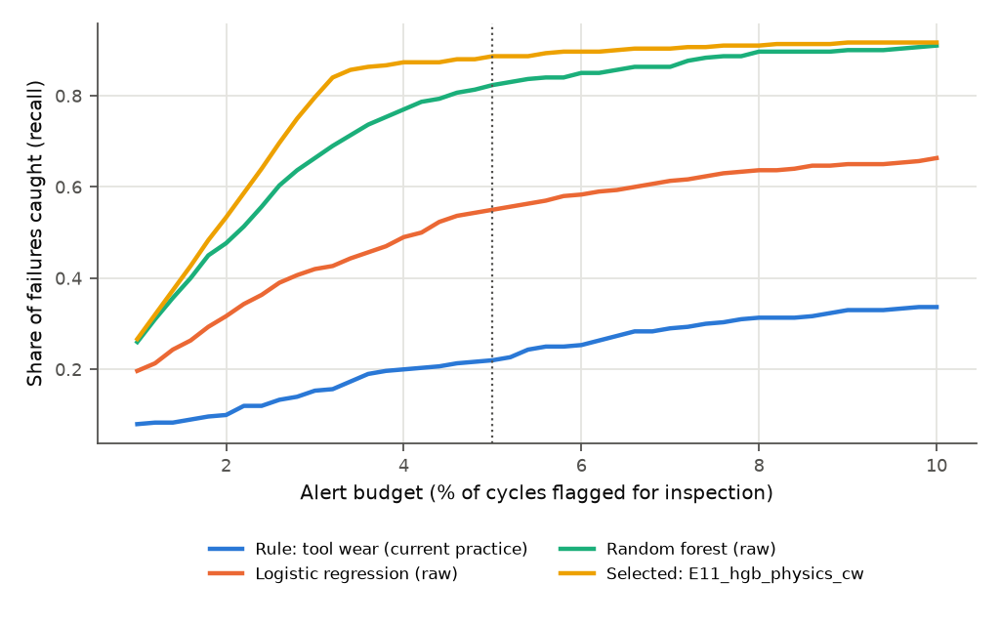
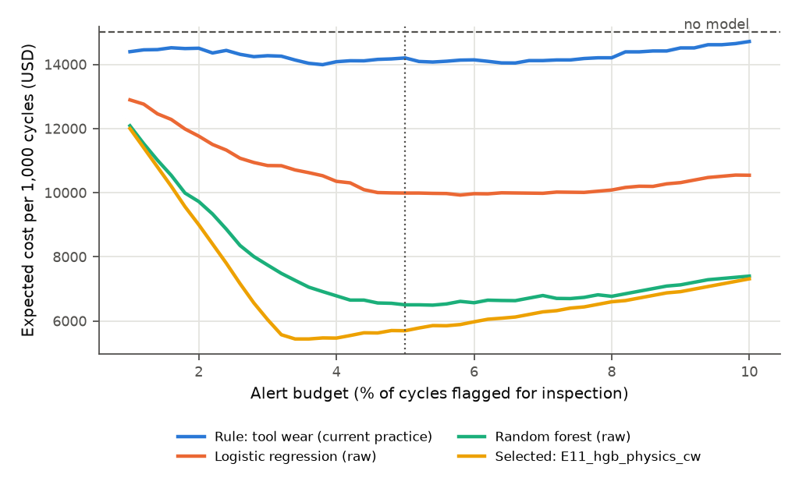
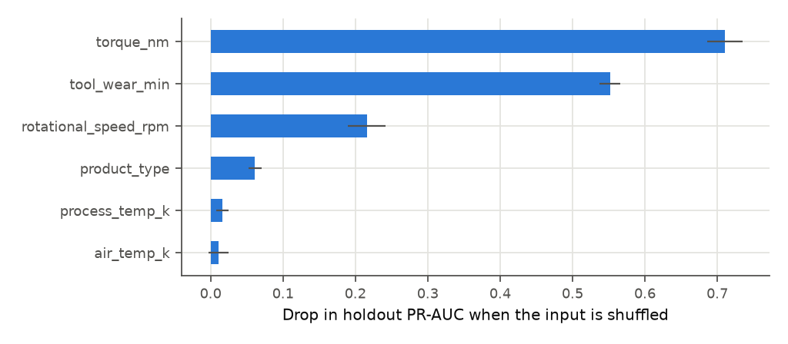

::: cover
<div class="course">DDM501 · AI in DevOps, DataOps, MLOps · Individual Assignment 2</div>

# ML Pipeline Design and MLOps Analysis: Failure-Risk Model for a CNC Line

<div class="subtitle">Continuation of Assignment 1: pipeline, experiment tracking, orchestration and reproducibility, with real runs on the AI4I 2020 dataset</div>

|                |                    |
|----------------|--------------------|
| Student name   | [Name]             |
| Student ID     | [StudentID]        |
| Class          | [Class]            |
| GitHub         | maxnguyen83        |
| Code           | repository `ddm501-assignment2-ml-pipeline` (Python package `pm_pipeline`) |
| Submitted      | October 2026       |
:::

**Summary.** This report turns the Assignment 1 design into a working, tested training pipeline. It has eight stages (ingest, validate, preprocess, feature engineering, train, evaluate, register, deploy smoke test) packaged as the Python package `pm_pipeline`. The same stage functions run from a CLI, from pytest and from an Airflow 2.8 DAG. Fourteen experiment configurations were executed and tracked in MLflow; every number in this report comes from those runs. The selected model, a histogram gradient-boosting classifier with physics features and class weights (E11), catches **88.7 %** of failures in cross-validation (95 % CI 0.85–0.92) and **76.9 %** on a later, time-ordered holdout when 5 % of cycles are flagged. The current tool-wear rule catches 22.0 % in cross-validation. Under the assumed cost model, the selected model cuts expected failure cost per 1,000 cycles from USD 15,000 to USD 5,695. Two complete runs gave the same metrics to within 2.2 × 10⁻¹⁶.

## 0. Recap of Assignment 1 and what changed

**Problem (Assignment 1).** Line 2 of a mid-size Vietnamese machining plant (16 CNC mills, about 5,000 cycles a month) loses about 306 h a month to unplanned failure stops. The system scores each cycle at job start and alerts the maintenance team about the riskiest **5 % of cycles**, which is their capacity. Plant figures are labelled assumptions. The public AI4I 2020 dataset (10,000 cycles, 3.39 % failures, CC BY 4.0) stands in for the plant history.

**Architecture (Assignment 1).** Edge gateway and MQTT feed an ingestion service and TimescaleDB. Weekly snapshots go to MinIO. Airflow runs weekly training; MLflow handles tracking and the registry. A FastAPI scoring service loads `@champion` and has fallback rules. Grafana serves planners, and a drift and recall monitor can trigger retraining. All of it runs on two on-premise servers with Docker Compose.

**Refinements made here (Sessions 3–5).**

1. Model stages were replaced by **registry aliases** (`champion`, `challenger`, `previous`). A new model that beats the champion becomes `challenger`, and a person promotes it after the shadow week (`pm-pipeline promote`). This implements the automation-versus-control decision (T4) of Assignment 1.
2. The **operating threshold is stored as a tag on the model version**, so the service can never pair a model with another model's threshold.
3. Feature code lives **inside the logged sklearn Pipeline**, which removes training/serving skew without a feature store.
4. Two orchestration findings came from actually running Airflow. SLAs are not allowed on mapped tasks, and a strict configuration loader clashed with an Airflow environment variable. Both are described in Section 3.

## 1. Pipeline design

### 1.1 Pipeline architecture

{width=100%}

### 1.2 Stage specifications

| Stage (function) | Purpose | Input → Output | Key operations | Quality gate |
|----------|------------|--------------|--------------------|--------------|
| 1 Ingest (`stage_ingest`) | Get exactly the expected raw data | UCI zip / weekly extract → `ai4i2020.csv` + sha256 | Download if missing, extract, hash | sha256 must equal the pinned value, else `IngestError` |
| 2 Validate (`stage_validate`) | Stop bad data before it reaches a model | raw CSV → `validation_report.json` | 14-column schema and dtypes, nulls, duplicate IDs, physical ranges (e.g. air 290–310 K), allowed variants, binary labels, failure-rate band 1–10 %, label consistency | Any error blocks; known quirks (9 failures without mode, 18 random flags without failure) are logged warnings |
| 3 Preprocess (`stage_preprocess`) | Remove leakage and simulate deployment | raw CSV → `dev.parquet` (8,000) + `test.parquet` (2,000) | Rename to snake_case with units, cast types, sort by production order, drop `product_id` and the five mode flags, **time-ordered split** (last 20 % = holdout) | Split must not overlap and must respect order (unit tested) |
| 4 Feature engineering (`stage_features`) | Add domain features; save drift reference | dev parquet → `feature_profile.json` | Temperature gap [K], mechanical power = torque × rpm × 2π/60 [W], tool wear × torque [Nm·min]; per-feature mean, std and p01/p50/p99 | Features finite; power and temperature gap strictly positive |
| 5 Train (`cross_val_scores`, `fit_model`) | Fit one candidate configuration | dev → out-of-fold (OOF) scores + fitted Pipeline | 5-fold stratified CV; resampling *inside* training folds only; refit on all dev rows | Fixed seed; spec validated before compute |
| 6 Evaluate (`evaluate_scores`) | Measure what the business cares about | OOF and holdout scores → MLflow metrics + artefacts | Threshold = top 5 % of OOF scores, then applied unchanged to the holdout; recall/precision at budget, PR-AUC, ROC-AUC, Brier, cost and downtime per 1,000 cycles, per-mode recall, bootstrap CI, permutation importance | Metrics logged for every run, including the baselines |
| 7 Select + register (`select_best`, `register_best`) | Promote only clearly better models | MLflow runs → registry version + alias | Tolerance-based selection; version tags (data hash, commit, threshold); alias logic | Primary metric ≥ 0.70 **and** ≥ +0.10 over the rule baseline |
| 8 Deploy smoke test (`load_champion`, `score_batch`) | Prove the registered artefact works as the service will use it | alias → scored holdout | Load `models:/ai4i-failure-risk@<alias>`, score 2,000 cycles | Alert rate must be in (0, 15 %], else fail |

Monitoring (drift against `feature_profile.json`, online recall from CMMS labels) is part of the Assignment 1 design. The feature profile is produced here, but the monitoring service itself is outside this assignment's code.

### 1.3 Design rationale

**Structure.** Each stage is a function with file inputs and outputs that returns a small JSON-serialisable dict (paths, hash, counts). Airflow passes only these dicts through XCom, never DataFrames. Every task can therefore be retried on its own from its parent's files, and a failed run can be inspected on disk. Data stages run once. Model stages run once per configuration, so adding an experiment means one more YAML entry and no new code.

**Modularity and reuse.** The same functions are called by the CLI (`pm-pipeline run`), by the Airflow tasks and by the tests, so the DAG is a thin wrapper of about ten lines per task. Each candidate is a single sklearn `Pipeline` (`PhysicsFeatures` → `ColumnTransformer` → estimator). The registered artefact therefore takes the six raw inputs and computes features itself, and the scoring service cannot compute a feature differently from training (Kästner, 2025, ch. 10; Hulten, 2018, p. 136). The feature functions are written once and used both by the feature stage (profiling) and inside the model. Configuration, the experiment matrix and code are separate files, so a cost assumption changes without touching code.

**Error handling and recovery.** Failures are classified, because a retry only helps some of them:

| Failure type | Example | Handling |
|------------|-------------------|------------------------------|
| Transient | network error during download, MLflow DB locked | Airflow retries twice with exponential backoff (5 → 30 min) |
| Data | hash mismatch, schema or range error | Fail at once (`IngestError`, `AirflowFailException`); a retry cannot fix data; alert the data owner |
| Model quality | candidate below gates | Not an error: registration is skipped, the champion stays, the ML team is alerted |
| Partial progress | crash after some runs | Re-running is safe: registration is idempotent (an already registered run is reused, tested) and data stages are deterministic |
| Post-deployment | registered model cannot load or alerts on everything | Smoke test fails the DAG before promotion; rollback = `promote --version <previous>` |

**Scalability.** The data is small: 10,000 rows, a full 14-run matrix took 149 s on a laptop, and one gradient-boosting fit took about 5 s. At the Assignment 1 growth target (6 lines, about 30,000 cycles a month) a year of data is under 400,000 rows, still a single-node job. The scaling path is already in the design:

* the 14 configurations are independent mapped tasks (`max_active_tis_per_dag=4`), so they spread over more workers with the Celery or Kubernetes executor without code changes;
* parquet snapshots partition naturally by week;
* MLflow moves from SQLite to PostgreSQL with MinIO artefacts by changing two environment variables.

Distributed training (Spark, Ray) is not justified for tabular data of this size.

## 2. Experiment tracking and metrics analysis

### 2.1 Experiment design

**Variables.**

| Variable | Values tested | Why |
|------------|--------------------|------------------------------|
| Algorithm | rule (tool wear), logistic regression, random forest, histogram gradient boosting, LightGBM | From current practice to strong tabular learners |
| Hyperparameters | per family (trees, depth/leaves, learning rate, C) | Kept at sensible defaults; the matrix studies design choices, not fine tuning |
| Features | `raw` (5 sensor values + variant) vs `physics` (+ 3 engineered features) | Tests the value of domain knowledge (Huyen, 2022, ch. 5, pp. 120–123) |
| Preprocessing / imbalance | none, class weights, random undersampling to 1:3, random oversampling to 1:3 (no SMOTE) | 3.4 % positives (Huyen, 2022, ch. 4, pp. 102–113); SMOTE avoided because it invents synthetic machine states |

**Baselines** (Huyen, 2022, ch. 6, pp. 179–181). E01 is the *existing-practice heuristic*: rank cycles by tool wear. E02 is the *simple ML baseline*: unweighted logistic regression on raw inputs. A random alert list would catch 5 % of failures at a 5 % budget.

**Protocol.** Development set = first 8,000 cycles in production order (300 failures). Holdout = last 2,000 (39 failures). Selection uses only 5-fold stratified CV on the development set. The holdout is scored once per run and never used to choose. The operating threshold is fixed on the out-of-fold scores (the score of the 400th riskiest of 8,000 cycles) and applied unchanged to the holdout. 95 % confidence intervals come from 500 bootstrap resamples.

**Experiment matrix (all 14 executed).**

| ID | Algorithm | Features | Imbalance | Key hyperparameters | Question |
|--|--------|------|--------|----------------|--------------------|
| E01 | Rule: rank by tool wear | raw | none | feature = tool_wear_min | Current practice (baseline) |
| E02 | Logistic regression | raw | none | C = 1, scaled | Simple ML baseline |
| E03 | Logistic regression | raw | class weights | C = 1 | Does reweighting help a linear model? |
| E04 | Logistic regression | physics | class weights | C = 1 | Do physics features rescue a linear model? |
| E05 | Random forest | raw | none | 300 trees, min leaf 2 | Non-linear baseline |
| E06 | Random forest | raw | balanced subsample | same | Weighting in bagging |
| E07 | Random forest | physics | balanced subsample | same | Features + weighting |
| E08 | Random forest | physics | undersample 1:3 | same | Data-level resampling |
| E09 | Hist. gradient boosting | raw | none | lr 0.1, 300 iter, 31 leaves | Boosting, raw inputs |
| E10 | Hist. gradient boosting | physics | none | same | Boosting + features |
| E11 | Hist. gradient boosting | physics | class weights | same | + weighting |
| E12 | LightGBM | physics | none | 400 trees, lr 0.05, 15 leaves | Second booster, smaller trees |
| E13 | LightGBM | physics | oversample 1:3 | same | Data-level oversampling |
| E14 | LightGBM | raw | class weights | same | Feature ablation for LightGBM |

### 2.2 Metrics strategy

| Role | Metric | Reason |
|--------|------------|------------------------------|
| **Primary** | **Recall at a 5 % alert budget** (CV, out-of-fold) | Technician capacity is the binding constraint; it answers "what share of failures falls inside the cycles we can inspect?" |
| Secondary | PR-AUC (average precision) | Threshold-free ranking quality on the rare class; tie-breaker in selection (Huyen, 2022, ch. 4, p. 108) |
| Secondary | Expected cost and downtime per 1,000 cycles | Business translation (below) |
| Secondary | Recall/precision at the *fixed* threshold, realised alert rate on holdout | What operations will actually see when the threshold meets new data |
| Secondary | Brier score, ROC-AUC | Calibration matters because planners see probabilities (Huyen, 2022, ch. 6, pp. 183–184) |
| Guardrail | Recall per failure mode (tool wear, heat, power, overstrain) | A good average can hide a mechanism the model ignores (Kästner, 2025, ch. 15, slicing) |
| Operational | Inference latency per 1,000 rows, model size, fit time | Must fit the 2 s alert budget and a small server; not used for selection except exact ties |

**Business–model alignment.** The cost model (configuration, Assignment 1 assumptions A5–A7) assigns USD 400 and 1.8 h of downtime to a missed failure, USD 100 and 0.4 h to a caught one, and USD 40 and 0.25 h to a false alarm. `evaluate_scores` turns every confusion matrix into **cost per 1,000 cycles** and **downtime reduction versus no model**. Flagging is worth it above a failure probability of 40/340 ≈ 0.12. With no model, every failure is unplanned: USD 15,000 per 1,000 cycles on the development period (3.75 % failures) and USD 7,800 on the holdout (1.95 %). Accuracy is not reported at all: a model that never alerts scores 96.6 %.

### 2.3 Code: experiment setup, logging and registration

MLflow uses a SQLite backend and a project-local artefact store (`mlflow.db`, `mlartifacts/`, both overridable with environment variables). The experiment is created with an explicit artefact location (`src/pm_pipeline/tracking.py`):

```python
def setup_mlflow(cfg: TrackingConfig) -> str:
    mlflow.set_tracking_uri(cfg.tracking_uri)
    mlflow.set_registry_uri(cfg.tracking_uri)
    client = MlflowClient()
    experiment = client.get_experiment_by_name(cfg.experiment_name)
    if experiment is None:
        experiment_id = client.create_experiment(
            cfg.experiment_name,
            artifact_location=cfg.artifact_location,
            tags={"project": "ddm501-predictive-maintenance", "dataset": "uci-ai4i-2020"},
        )
    else:
        experiment_id = experiment.experiment_id
    mlflow.set_experiment(experiment_id=experiment_id)
    return experiment_id
```

Each configuration is one run with provenance tags, parameters, metrics and artefacts (`src/pm_pipeline/pipeline.py`, abridged):

```python
with mlflow.start_run(run_name=spec.name) as run:
    mlflow.set_tags(
        {
            "pipeline_stage": "candidate",
            "pipeline_version": __version__,
            "git_commit": git_commit(),
            "data_sha256": data_sha256,
            "model_family": spec.model,
        }
    )
    mlflow.log_params(
        {
            "model": spec.model,
            "feature_set": spec.feature_set,
            "imbalance": spec.imbalance,
            "seed": cfg.seed,
            "cv_folds": cfg.split.cv_folds,
            "alert_budget": ev.alert_budget,
            **{f"hp_{k}": v for k, v in spec.params.items()},
        }
    )
    oof, _ = cross_val_scores(spec, x_dev, y_dev, cfg.split.cv_folds, cfg.seed)
    threshold = threshold_for_alert_rate(oof, ev.alert_budget)
    cv_metrics = evaluate_scores(
        y_dev, oof, threshold, ev.alert_budget, ev.costs, modes_dev, ev.downtime_hours
    )
    model = fit_model(spec, x_dev, y_dev, cfg.seed)
    test_scores = model.predict_proba(x_test)[:, 1]
    ...
    mlflow.log_metrics(
        {
            **_prefixed("cv", cv_metrics),
            **_prefixed("test", test_metrics),
            "threshold": threshold,
            "latency_ms_per_1000": ...,
        }
    )
    # PR curve, OOF scores, permutation importance and threshold.json
    mlflow.log_artifacts(str(tmp_path), artifact_path="evaluation")
    mlflow.sklearn.log_model(
        model,
        artifact_path="model",
        signature=infer_signature(x_test, test_scores),
        input_example=x_test.head(3),
        code_paths=[str(Path(__file__).resolve().parent)],
        pip_requirements=_model_requirements(),
    )
```

`code_paths` and pinned `pip_requirements` are stored with the model because the pickled pipeline references the package's own classes (`PhysicsFeatures`, `ToolWearRule`). The model store then holds the featurising code and dependencies as well as the weights (Huyen, 2022, ch. 10, pp. 322–323).

Registration applies the gates, creates a version (or reuses it on a retry), tags it and moves aliases (`src/pm_pipeline/register.py`, abridged):

```python
existing = [
    mv for mv in client.search_model_versions(f"name = '{name}'") if mv.run_id == selection.run_id
]
version = (
    existing[0] if existing else mlflow.register_model(f"runs:/{selection.run_id}/model", name)
)
for key, value in {
    "run_name": selection.run_name,
    "cv_recall_at_budget": f"{selection.value:.4f}",
    "data_sha256": run.data.tags["data_sha256"],
    "git_commit": run.data.tags["git_commit"],
    "threshold": f"{run.data.metrics['threshold']:.6f}",
}.items():
    client.set_model_version_tag(name, version.version, key, value)
champion = _alias_version(client, name, "champion")
if champion is None or (cfg.registry.auto_promote and selection.value > champion_value):
    promote(cfg, str(version.version))  # old champion -> alias "previous"
else:
    client.set_registered_model_alias(name, "challenger", version.version)
```

{width=92%}

{width=92%}

### 2.4 Results

The table is generated from MLflow by `scripts/make_figures.py` (the full version with 19 columns is `reports/experiment_results.md`, written by `pm-pipeline results`). Rows are sorted by the primary metric.

| # | Run | CV recall@5 % [95 % CI] | CV PR-AUC | CV cost / 1k cycles (USD) | CV downtime reduction | Holdout recall@5 % [95 % CI] | Holdout recall, fixed threshold | Holdout alert rate | Holdout downtime reduction |
|-|------------|----------|-----|-----|-----|----------|-----|-----|-----|
| 1 | E07_rf_physics_cw | 0.890 [0.85, 0.92] | 0.901 | 5,652 | 63.1% | 0.795 [0.67, 0.92] | 0.718 | 2.6% | 47.3% |
| 2 | E08_rf_physics_under | 0.890 [0.85, 0.92] | 0.875 | 5,652 | 63.1% | 0.821 [0.72, 0.94] | 0.718 | 2.4% | 48.7% |
| 3 | **E11_hgb_physics_cw** | **0.887 [0.85, 0.92]** | **0.907** | **5,695** | **62.8%** | **0.769 [0.64, 0.90]** | **0.718** | **2.9%** | **44.8%** |
| 4 | E12_lgbm_physics | 0.887 [0.85, 0.92] | 0.907 | 5,695 | 62.8% | 0.821 [0.67, 0.93] | 0.744 | 3.2% | 45.4% |
| 5 | E13_lgbm_physics_over | 0.883 [0.85, 0.91] | 0.907 | 5,738 | 62.5% | 0.821 [0.68, 0.93] | 0.744 | 3.2% | 45.4% |
| 6 | E10_hgb_physics | 0.883 [0.85, 0.92] | 0.898 | 5,738 | 62.5% | 0.744 [0.59, 0.87] | 0.718 | 2.9% | 45.5% |
| 7 | E09_hgb_raw | 0.840 [0.80, 0.88] | 0.817 | 6,290 | 58.5% | 0.795 [0.66, 0.91] | 0.744 | 3.3% | 44.7% |
| 8 | E14_lgbm_raw_cw | 0.830 [0.79, 0.87] | 0.803 | 6,418 | 57.6% | 0.769 [0.64, 0.90] | 0.744 | 2.9% | 47.9% |
| 9 | E05_rf_raw | 0.823 [0.78, 0.86] | 0.803 | 6,502 | 57.0% | 0.821 [0.70, 0.93] | 0.667 | 2.1% | 45.8% |
| 10 | E06_rf_raw_cw | 0.793 [0.75, 0.84] | 0.765 | 6,885 | 54.2% | 0.769 [0.64, 0.91] | 0.667 | 2.0% | 46.9% |
| 11 | E04_logreg_physics_cw | 0.553 [0.50, 0.60] | 0.459 | 9,945 | 32.2% | 0.641 [0.46, 0.77] | 0.256 | 1.1% | 15.7% |
| 12 | E02_logreg_raw | 0.550 [0.50, 0.60] | 0.452 | 9,988 | 31.9% | 0.641 [0.50, 0.79] | 0.333 | 1.1% | 22.7% |
| 13 | E03_logreg_raw_cw | 0.520 [0.47, 0.57] | 0.429 | 10,370 | 29.1% | 0.667 [0.52, 0.81] | 0.231 | 0.7% | 16.2% |
| 14 | E01_rule_toolwear | 0.220 [0.18, 0.27] | 0.119 | 14,200 | 1.6% | 0.641 [0.47, 0.77] | 0.410 | 3.3% | 14.1% |

{width=78%}

{width=78%}

**Recall by failure mode** (share of real failures of that mode inside the alerts at the fixed threshold; development counts: tool wear 36, heat 115, power 85, overstrain 77; holdout: tool wear 10, heat 0, power 10, overstrain 21):

| Run | CV tool wear | CV heat | CV power | CV overstrain | Holdout tool wear | Holdout power | Holdout overstrain |
|------------|----|----|----|----|----|----|----|
| E01 rule | 0.78 | 0.08 | 0.05 | 0.42 | 0.50 | 0.00 | 0.48 |
| E02 logistic regression | 0.11 | 0.39 | 0.89 | 0.78 | 0.10 | 0.70 | 0.43 |
| E05 random forest (raw) | 0.19 | 0.97 | 0.88 | 0.95 | 0.10 | 0.90 | 0.95 |
| **E11 selected** | **0.31** | **1.00** | **0.99** | **0.99** | **0.10** | **1.00** | **1.00** |

{width=70%}

**Patterns.**

1. **Model family matters most.** Every tree ensemble beats both baselines by a wide margin: 0.79–0.89 CV recall against 0.55 for logistic regression and 0.22 for the rule. Logistic regression cannot represent the failure physics. A heat failure needs a small temperature gap *and* low speed, and a power failure happens when power is *either* too low *or* too high, which no single linear weight can express. That is also why giving it physics features did nothing (E04 0.553 vs E02 0.550).
2. **Domain features help trees clearly.** Adding the three physics features raised CV recall by 4–7 points and PR-AUC by about 0.10 for each tree family: RF 0.823 → 0.890 (E05 → E07), HGB 0.840 → 0.883 (E09 → E10), LightGBM 0.830 → 0.887 (E14 → E12). The trees can find the products themselves, but only with many more splits.
3. **Imbalance handling hardly changes ranking.** Within a family the differences are at most 0.03, well inside the confidence intervals (E10 vs E11: 0.883 vs 0.887; E12 vs E13: 0.887 vs 0.883). The primary metric depends only on the *order* of scores, and reweighting mainly rescales probabilities. Undersampling did hurt calibration and PR-AUC: E08 has Brier 0.022 and PR-AUC 0.875, against 0.009 and 0.901 for the class-weighted E07. Resampling is applied only to training folds, so validation always reflects the real 3.75 % rate (Huyen, 2022, ch. 4, p. 110).
4. **The top six are statistically tied.** Their CV recall lies between 0.883 and 0.890 with overlapping intervals of about ±0.035. That is why the selection rule treats differences below 0.01 (three failures) as ties.
5. **Time shift is real.** On the later holdout, recall at 5 % falls to 0.74–0.82 and the *fixed* threshold flags only 2.4–3.3 % of cycles instead of 5 %. The holdout has half the failure rate (1.95 % vs 3.75 %) and no heat failures, which in the dev period clustered in one hot period (108 of 115 in cycles 4,001–5,000). This is label shift plus a change in failure mix (Huyen, 2022, ch. 8, pp. 237–241). Two consequences follow. The weekly retraining must also recompute the threshold. And permutation importance on the holdout ranks temperature low only because that period has no heat failures.
6. **Tool-wear failures are the blind spot.** No configuration catches them well: E11 gets 0.31 in CV and 1 of 10 in the holdout. In the data they occur at a random point between 200 and 240 min of wear. A guardrail rule "alert if wear ≥ 200 min" would flag 8 % of all cycles to catch 45 tool-wear failures, a precision of about 5.6 %, below the 12 % break-even. A scheduled tool change at 200 min, a non-ML control, is the better answer.

**Trade-offs between metrics.** *Recall against alert volume*: a 3 % budget would give E11 a recall of 0.80, 5 % gives 0.887 and 8 % gives 0.91, so beyond 5 % extra alerts buy little. *Cost against recall*: cost is lowest at about 3.7 % (0.867 recall), but the curve is flat from 3.5 % to 5.5 %. Using the full 5 % costs USD 265 more per 1,000 cycles and catches about two more failures per 100, and planners prefer it. *Ranking against calibration*: PR-AUC is almost equal across the top models, but Brier separates them (E11 0.0067 best, E08 0.0217 worst), which matters for the displayed probability. *Rank-based against fixed threshold*: ranking within a shift would use the full budget (holdout 0.769) where the fixed threshold under-alerts (0.718).

**Recommendation: E11, histogram gradient boosting with physics features and class weights.**

* It was selected by the pre-declared rule: within 0.01 of the best CV recall, then the highest CV PR-AUC (0.907).
* It passes both gates: 0.887 ≥ 0.70, and a lift of +0.667 over the rule.
* It has the best calibration of all candidates (Brier 0.0067 CV, 0.0061 holdout).
* It is native to scikit-learn, so the serving image needs no extra native library.

Under the cost model it reduces expected cost per 1,000 cycles from USD 15,000 to 5,695 (CV) and from 7,800 to 4,220 (holdout), and downtime by 62.8 % and 44.8 %. That is above the 30 % business target even on the harder period, before the 80 % action-rate discount assumed in Assignment 1. On the holdout it meets the 0.70 gate of Assignment 1 (0.769 ranked, 0.718 at the fixed threshold) but not the 0.80 stretch target.

E12 (LightGBM) is an equivalent alternative. It caught 32 rather than 30 of 39 holdout failures, but that difference is inside the confidence intervals, and choosing on the holdout would make it a second validation set. E12 is kept as the first challenger to watch during the shadow week.

The model is synthetic-data evidence only. Before go-live it needs the shadow week from Assignment 1 and online recall on real CMMS labels.

## 3. Workflow orchestration design

### 3.1 DAG architecture

{width=62%}

| Task | What it does | Output (XCom) |
|----------|------------------------------|--------------------|
| `ingest` | Download if missing, verify sha256 | raw path, sha256, size |
| `validate` | Data gate; `AirflowFailException` on error (no retry) | report path, label statistics |
| `preprocess` | Clean, drop leakage, time-ordered split → parquet | dev/test paths, sizes, failure rates |
| `build_features` | Feature gate, drift reference profile | profile path |
| `list_experiments` | Read `experiments.yaml` | list of 14 names |
| `train_candidate` (mapped ×14) | Train, evaluate and log one configuration | run id, headline metrics |
| `results_table` | Regenerate the results table from MLflow | Markdown path |
| `select_and_register` | Selection rule, gates, register, aliases; skip if gates fail | version, alias |
| `smoke_test_champion` | Load the new version by alias, score holdout, check alert rate | version, alert rate |

**Dependencies.**

* `preprocess` needs both the file (`ingest`) and the verdict (`validate`), so invalid data never reaches a split.
* `list_experiments` has no upstream and runs in parallel with the data stages.
* `train_candidate` is mapped over its output with `.partial(...).expand(name=...)`, so the number of training tasks follows the YAML file and needs no DAG change.
* `results_table` and `select_and_register` wait for all mapped instances.
* The smoke test needs the registration result and the holdout path.

### 3.2 Scheduling strategy

* **Trigger type.** Time-based cron as the default, plus manual or REST API triggers. The drift monitor calls the API when feature drift or a drop in online recall crosses its threshold. Data-aware scheduling (Airflow Datasets) is the natural next step once the weekly snapshot job runs in Airflow too.
* **Frequency.** Weekly, Monday 02:00 Asia/Ho_Chi_Minh (`0 2 * * 1`). The CMMS closes the week's work orders on Sunday, 02:00 is the quietest hour on the on-prem server, and the new challenger can start its shadow week on Monday morning. Daily runs would add only about six failures per run, mostly noise (Huyen, 2022, ch. 9, pp. 279–281).
* **Other settings.** `catchup=False`: missed weeks are not back-filled, because only the latest data matters. `max_active_runs=1`: two runs would race on the registry aliases. `dagrun_timeout=3h`.

### 3.3 Code: DAG, tasks and dependencies

```python
default_args = {
    "owner": "ml-team",
    "retries": 2,
    "retry_delay": timedelta(minutes=5),
    "retry_exponential_backoff": True,
    "max_retry_delay": timedelta(minutes=30),
    "execution_timeout": timedelta(minutes=30),
    "on_failure_callback": notify_failure,
}


@dag(
    dag_id="pm_failure_risk_training",
    schedule="0 2 * * 1",
    start_date=pendulum.datetime(2026, 1, 5, tz="Asia/Ho_Chi_Minh"),
    catchup=False,
    max_active_runs=1,
    dagrun_timeout=timedelta(hours=3),
    default_args=default_args,
    sla_miss_callback=notify_sla_miss,
    tags=["ddm501", "predictive-maintenance", "training"],
    doc_md=__doc__,
)
def pm_failure_risk_training() -> None:
    @task
    def validate(ingested: dict[str, Any]) -> dict[str, Any]:
        """Run the data quality gate; bad data fails at once because a retry cannot fix it."""
        from pm_pipeline.pipeline import stage_validate
        from pm_pipeline.validate import DataValidationError

        cfg = _cfg()
        try:
            return stage_validate(cfg, ingested["raw_path"], _run_dir(cfg))
        except DataValidationError as exc:
            raise AirflowFailException(f"data validation failed: {exc}") from exc

    # Airflow does not support SLAs on mapped tasks, so the SLA sits on registration.
    @task(max_active_tis_per_dag=4)
    def train_candidate(
        name: str, split: dict[str, Any], ingested: dict[str, Any], features: dict[str, Any]
    ) -> dict[str, Any]:
        from pm_pipeline.config import load_experiments
        from pm_pipeline.pipeline import stage_train_candidate

        cfg = _cfg()
        spec = next(s for s in load_experiments(EXPERIMENTS_PATH) if s.name == name)
        return stage_train_candidate(
            cfg, spec, split["dev_path"], split["test_path"], ingested["sha256"], _run_dir(cfg)
        )

    ...
    ingested = ingest()
    validated = validate(ingested)
    split = preprocess(ingested, validated)
    features = build_features(split)
    candidates = train_candidate.partial(split=split, ingested=ingested, features=features).expand(
        name=list_experiments()
    )
    results_table(candidates)
    registration = select_and_register(candidates)
    smoke_test_champion(registration, split)


pm_failure_risk_training()
```

Package imports sit inside the tasks. The scheduler parses the file every few seconds and should not import scikit-learn and MLflow to do so; the parse check below ran in a plain Airflow image without them.

### 3.4 Operational considerations

**Failure handling.** Retries with exponential backoff cover transient errors. Data errors fail without retry. Gate failures raise `AirflowSkipException`, so the smoke test is skipped and the DAG run is not red, because "no better model this week" is a normal outcome. `execution_timeout` (30 min per task) and `dagrun_timeout` (3 h) stop hung runs. Every task works from files of its parents, so a single task can be cleared and re-run.

**Alerting.**

* `on_failure_callback` fires when a task has used up its retries, and posts to a chat webhook. The webhook URL comes from the environment (`PM_ALERT_WEBHOOK_URL`, injected from the Airflow secrets backend), never from code.
* A gate failure sends an explicit message.
* `sla_miss_callback` fires if registration has not finished 2 h after the scheduled start. The SLA had to move to registration: the first parse in Airflow 2.8.4 failed with *"SLAs are unsupported with mapped tasks"* when it was on `train_candidate`.

**Monitoring.** The Airflow UI and metadata DB give task durations and failure history. MLflow shows the metric history across weekly runs, and a falling CV recall over weeks is an early drift signal. The service-side monitoring (Prometheus, drift job) is from Assignment 1.

**Evidence.** The final DAG file was parsed in `apache/airflow:2.8.4-python3.11`: `import_errors: {}`, 9 tasks, retries = 2, the SLA on `select_and_register`, schedule and time zone as above (`reports/airflow_dag_parse.txt`). An earlier revision of the DAG was also run end to end with `airflow dags test` in a derived image with the package installed. All tasks succeeded, including 14 mapped training tasks, and it registered the same model (E11, CV recall 0.8867) on Linux/Python 3.11 as on macOS/Python 3.12 (`reports/airflow_dags_test.log`). That run found a real bug. The image sets `PM_PROJECT_ROOT`, which the strict override loader rejected as an unknown configuration key, so `ingest` failed and went into retry. The fix is a list of reserved `PM_*` names plus a regression test. Two later changes, alias-aware smoke testing and the human promotion step, are covered by pytest and the re-parse. A second `dags test` could not be run because the shared Docker VM disk was full.

## 4. Code quality and documentation

**Code standards.**

* *Style.* Ruff lint with rule sets E, F, W, I, B, UP, D, N, SIM and RUF, plus `ruff format`, line length 100. Both report zero findings.
* *Docstrings.* Google style on every public function, enforced by the `D` rules, with Args/Returns/Raises where useful.
* *Type hints.* All function signatures, with `from __future__ import annotations` so the code also runs on Python 3.11 in the Airflow image.
* *Comments.* Comments explain *why*, not what. For example:

```python
def resample(
    x: pd.DataFrame, y: pd.Series, strategy: str, target_ratio: float, seed: int
) -> tuple[pd.DataFrame, pd.Series]:
    """Random under- or over-sampling to reach ``minority / majority = target_ratio``.

    Applied to training folds only - never to validation or test data, otherwise the
    measured precision and alert rate would not reflect the real failure rate.
    """
```

* *Tests.* 33 pytest tests (90 % line coverage of `pm_pipeline`). They cover the env-override rules, the hash pin, validation errors, leakage removal, time-split ordering, physics formulas against hand calculations, every metric against hand-computed values, resampling ratios, seeded determinism, all five model families, gates, and an end-to-end train → MLflow → register → promote → score test on a temporary store.

**Layout.** `src/pm_pipeline/` (one module per stage plus `config`, `tracking`, `results`, `cli`), `configs/`, `dags/`, `tests/`, `scripts/`, `docker/`, `reports/` (generated), `report/` (this document).

**Configuration.** One YAML file holds every tunable value; there are no hidden defaults (`configs/pipeline.yaml`, excerpt):

```yaml
seed: 42
data:
  raw_path: data/raw/ai4i2020.csv
  expected_sha256: dc6630cd9b1f0f853922fad78a1b6436570d3f1ec863f1dd5c4340ac56bc8a8e
split:
  test_fraction: 0.20
  cv_folds: 5
evaluation:
  alert_budget: 0.05
  costs:            # USD per outcome (assumptions A5-A7)
    false_negative: 400.0
    true_positive: 100.0
    false_positive: 40.0
    true_negative: 0.0
tracking:
  tracking_uri: sqlite:///mlflow.db
registry:
  model_name: ai4i-failure-risk
  selection_tolerance: 0.01
  min_primary_metric: 0.70
  min_lift_over_baseline: 0.10
  auto_promote: false
```

**Loading and environment variables.** `load_config()` reads the file named by `--config`, `PM_CONFIG` or the default path. It applies overrides of the form `PM_<SECTION>__<KEY>` and returns frozen, typed dataclasses. Relative paths resolve against the project root, so the CLI works from any directory. Precedence is environment variable, then file. An unknown key raises an error instead of being ignored, so a typo such as `PM_SEDE=1` cannot silently run with the wrong seed.

```python
def apply_env_overrides(
    raw: Mapping[str, Any], environ: Mapping[str, str] | None = None, prefix: str = ENV_PREFIX
) -> dict[str, Any]:
    env = os.environ if environ is None else environ
    result: dict[str, Any] = copy.deepcopy(dict(raw))
    for key, value in sorted(env.items()):
        if not key.startswith(prefix) or key in RESERVED_ENV:  # PM_CONFIG, PM_PROJECT_ROOT, ...
            continue
        path = key[len(prefix) :].lower().split("__")
        node: dict[str, Any] = result
        for part in path[:-1]:
            child = node.get(part)
            if not isinstance(child, dict):
                raise KeyError(f"{key}: '{part}' is not a config section")
            node = child
        if path[-1] not in node:
            raise KeyError(f"{key}: unknown config key '{path[-1]}'")
        node[path[-1]] = yaml.safe_load(value)  # "0.03" -> float, "true" -> bool
    return result
```

The same mechanism points the tests at a temporary MLflow store, the Docker image at `/app/state`, and the Airflow container at its own work directory, without editing the YAML file.

## 5. Reproducibility and versioning strategy

**Code versioning.**

* *Branching.* GitHub flow: `main` is protected and always releasable. Work happens on short-lived `feature/*` and `fix/*` branches merged by pull request after CI passes (ruff, ruff format check, pytest).
* *Releases.* Semantic version tags `vMAJOR.MINOR.PATCH` match `pm_pipeline.__version__` (0.3.0 now). A release builds the Docker image tagged with the version and the commit SHA.
* *Data-only retraining.* Weekly retraining does not create commits. Only the data hash changes, and it is recorded on the run.

{width=62%}

**Data versioning.** The raw file is pinned by sha256 in the configuration. Ingest refuses any other bytes, and the hash is logged as a tag on every run and copied to the registered version. Any model can therefore be traced to the exact data it was trained on. In the plant, each weekly snapshot is written once to MinIO under a dated path (`snapshots/line2/2026-W41/cycles.parquet`) with its hash, and the pipeline config of that run names the snapshot. That gives the same guarantee without new tools. DVC becomes worthwhile when snapshots are too large to keep in full or when several datasets have to be versioned together (Huyen, 2022, ch. 6, p. 164; Kästner, 2025, ch. 24). Label corrections from the CMMS create a new snapshot rather than editing an old one.

**Model versioning.**

| Element | Convention |
|-------------|------------------------------|
| Registered model name | `<prediction-target>`, here `ai4i-failure-risk`; one name per task, not per algorithm |
| Version | integer assigned by MLflow on registration; never reused |
| Aliases | `champion` (served), `challenger` (passed gates, in shadow), `previous` (rollback target) |
| Version tags | `run_name`, `cv_recall_at_budget`, `data_sha256`, `git_commit`, `feature_set`, `threshold` |
| Run naming | `E<NN>_<model>_<features>[_<imbalance>]`, stable across weeks so results can be compared over time |
| Rollback | `pm-pipeline promote --version <previous>`: an alias move, no redeploy |

**Seeds and determinism.**

```python
def set_global_seed(seed: int) -> None:
    os.environ["PYTHONHASHSEED"] = str(seed)
    random.seed(seed)
    np.random.seed(seed)
```

The seed is also passed explicitly to every estimator, the CV splitter (`StratifiedKFold(..., random_state=seed)`), the resampling generator and the bootstrap. **Evidence:** the 14-run matrix was run twice into separate MLflow stores. The 48 quality metrics of all 14 runs agreed to within 2.2 × 10⁻¹⁶, which is floating-point rounding. Only timing metrics differed. The Airflow run on Linux with older numpy/pandas produced the same selection and the same CV recall for E11 (0.8867).

**Environment: Dockerfile and lock file.** `requirements.lock` pins all 76 packages, direct and transitive (generated with `uv pip compile` for Linux). The image installs the lock first, so code changes do not rebuild that layer:

```dockerfile
FROM python:3.12-slim AS runtime
RUN apt-get update && apt-get install -y --no-install-recommends libgomp1 \
    && rm -rf /var/lib/apt/lists/*
ARG GIT_COMMIT=unknown
ENV PYTHONHASHSEED=0 PIP_NO_CACHE_DIR=1 GIT_COMMIT=${GIT_COMMIT} \
    PM_CONFIG=/app/configs/pipeline.yaml \
    PM_TRACKING__TRACKING_URI=sqlite:////app/state/mlflow.db \
    PM_TRACKING__ARTIFACT_LOCATION=/app/state/mlartifacts PM_DATA__WORK_DIR=/app/state/interim
WORKDIR /app
COPY requirements.lock ./
RUN pip install -r requirements.lock
COPY pyproject.toml README.md ./
COPY src ./src
RUN pip install --no-deps .
COPY configs ./configs
COPY data/raw ./data/raw
RUN useradd --create-home --uid 10001 pipeline && mkdir -p /app/state /app/reports \
    && chown -R pipeline /app/state /app/reports
USER pipeline
ENTRYPOINT ["pm-pipeline"]
CMD ["--help"]
```

What was verified: `docker build --check` reports no warnings, and the install steps (lock file, then the package without dependencies, then `pm-pipeline --help`) succeed in a clean virtual environment. A full image build was not run, because the shared Docker VM had under 1 GB of free disk. A separate `docker/airflow.Dockerfile` built the image used for the Airflow end-to-end test.

## 6. Limitations and next steps

* **Synthetic data.** AI4I was generated from known rules, so the near-perfect recall on heat, power and overstrain failures is optimistic for a real line. The shadow week and online recall are the real test.
* **Threshold drift.** The fixed threshold under-used the budget on the holdout (2.9 % instead of 5 %). Next step: recompute the threshold weekly from the latest scores, and add per-shift ranking in the service.
* **Champion comparison.** The champion/challenger comparison uses the CV metric stored at registration. With changing data, both should be re-scored on the same latest window before promotion.
* **Tool-wear failures** need a different signal (vibration or spindle current) or stay with scheduled tool changes.

## References

* Hulten, G. (2018). *Building intelligent systems: A guide to machine learning engineering*. Apress. https://doi.org/10.1007/978-1-4842-3432-7
* Huyen, C. (2022). *Designing machine learning systems: An iterative process for production-ready applications*. O'Reilly Media.
* Kästner, C. (2025). *Machine learning in production: From models to products*. MIT Press. Online edition: https://mlip-cmu.github.io/book/ (chapters 10, 11, 15 and 24 cited).
* Matzka, S. (2020). Explainable artificial intelligence for predictive maintenance applications. *Third International Conference on Artificial Intelligence for Industries (AI4I 2020)*. https://doi.org/10.1109/AI4I49448.2020.00023
* UCI Machine Learning Repository. *AI4I 2020 Predictive Maintenance Dataset* (id 601), CC BY 4.0. https://archive.ics.uci.edu/dataset/601
* Apache Airflow 2.8 documentation: dynamic task mapping, SLAs, TaskFlow API. MLflow 2.x documentation: model registry aliases, `mlflow.sklearn.log_model`.

## Appendix. How to reproduce

```bash
python3.12 -m venv .venv && .venv/bin/pip install -e ".[dev]"
.venv/bin/pm-pipeline validate          # ingest + data gate
.venv/bin/pm-pipeline all               # 14 runs -> reports/experiment_results.md -> register
.venv/bin/python scripts/make_figures.py --out report/figures
.venv/bin/ruff check . && .venv/bin/ruff format --check . && .venv/bin/pytest -q
.venv/bin/mlflow ui --backend-store-uri sqlite:///mlflow.db      # browse runs and registry
./report/build.sh                       # diagrams + this PDF
```
